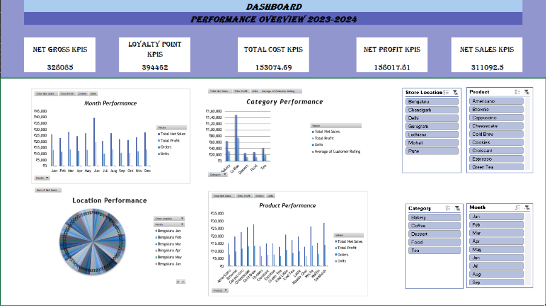

# ☕ Café Sales Analysis 2024

An Excel-based sales analysis of **1,600 café transactions** across **7 store locations** in 2024 — covering raw data, a documented cleaning process, pivot tables, and a dashboard with KPIs and charts.

---

## 📁 Dataset

| | |
|---|---|
| **File** | `Data_1.xlsx` |
| **Period** | 1 Jan 2024 – 31 Dec 2024 |
| **Transactions** | 1,600 (unique `Transaction ID`) |
| **Customers** | 297 unique `Customer ID`s |
| **Products** | 16 across 5 categories (Coffee, Tea, Bakery, Dessert, Food) |
| **Stores** | Bengaluru, Chandigarh, Delhi, Gurugram, Ludhiana, Mohali, Pune |
| **Staff** | 8 |

### Workbook structure

| Sheet | What's inside |
|---|---|
| `Uncleaned Data` | Original raw data, preserved unchanged (1,600 rows × 36 columns) |
| `Data Quality` | Cleaning report: what was fixed, rules applied, imputation summary |
| `Cleaned Data` | Final analysis-ready table with rebuilt financial formulas |
| `Pivot Analysis` | 13 pivot tables (month, category, product, location, channel, payment, campaign, staff, customer type, order status, rating, feedback) |
| `Charts` | Dashboard with KPI cards, charts and slicers (Month, Category, Product, Store Location) |

### Key columns

| Column | Description |
|---|---|
| `Transaction ID`, `Date`, `Time` | Order identifiers and timestamp |
| `Customer ID`, `Customer Type` | Customer and segment (Member / Regular / New Customer) |
| `Product`, `Category`, `Temperature`, `Size` | What was sold |
| `Quantity`, `Unit Price`, `Discount` | Order inputs |
| `Calculated Gross Sales`, `Discount Amount`, `Calculated Net Sales` | Rebuilt revenue fields |
| `Total Cost`, `Calculated Profit` | Rebuilt cost and profit fields |
| `Payment Method`, `Sales Channel`, `Store Location`, `Staff Name` | How and where it was sold |
| `Order Status`, `Customer Rating`, `Feedback`, `Delivery Minutes` | Fulfilment and satisfaction |
| `Campaign`, `Loyalty Points` | Marketing and loyalty |

---

## 🧹 Data Cleaning

Original data was kept untouched on its own sheet. Cleaning was done on a separate copy, and imputed cells are highlighted pale yellow in `Cleaned Data`.

| Check | Result |
|---|---|
| Rows reviewed → rows in cleaned table | 1,600 → 1,600 |
| Exact duplicate rows removed | 0 |
| Missing dates | 54 → filled with dataset median date (25 Jun 2024) |
| Missing quantities | 55 → 50 inferred exactly (gross sales ÷ unit price), 5 set to product mode |
| Customer Rating blanks | 224 → median (3) |
| Loyalty Points blanks | 131 → median (244) |
| Delivery Minutes blanks | 409 → median of the sales channel |
| Blank categorical cells | 689 → `Unknown` |
| Missing discount | Standardised to 0% |
| Financial columns | 8 columns rebuilt with live formulas |
| Date-derived columns | Year, Month, Day recalculated from `Date` |

---

## 📊 Dashboard

> Charts below are generated from the `Cleaned Data` sheet and mirror the Excel dashboard. 

   

---

## 🔍 Key Findings

- **Total net sales: 311,092.50** with **net profit of 158,017.81** — an overall margin of about **50.8%**.
- **June is the standout month** (39,701 net sales), well above the 20,000–28,000 range of every other month. July was the weakest (20,693).
- **Coffee drives the business**: 148,719 in net sales, about **48%** of the total. Margins are similar across categories (roughly 50–52%), so growth is mostly a volume story.
- **Top products by net sales:** Sandwich (28,758), Cold Brew (27,844), Mocha (26,668) and Cheesecake (25,950).
- **Locations are fairly even.** Chandigarh (49,121) and Pune (48,872) lead; Ludhiana (41,602) is lowest.
- **Online is the top channel** (102,137), followed by Walk-in (91,507) and Delivery App (54,947).
- **Card (115,650) and UPI (101,748)** together account for about 70% of sales.
- **Instagram is the best-performing named campaign** (95,471), ahead of Student, Weekend and Festive offers.
- **Customer ratings average about 3.3 / 5**, with little difference between segments or staff.

---

## ⚠️ Things to Know

- **Net sales include Cancelled and Pending orders.** Only 1,076 of 1,600 orders (67%) are `Completed`. Cancelled (52,649) and Pending (55,100) orders are still counted in the headline totals. Filter on `Order Status = Completed` for realised revenue (203,344 net sales).
- **Imputed values** (dates, ratings, loyalty points, delivery minutes) use medians, so ratings and delivery times are smoothed towards the middle. Treat them as approximate.
- **Many `Unknown` values** remain for campaign (429 orders), sales channel and payment method, which limits attribution analysis.
- The dashboard header reads "2023-2024", but the data covers **2024 only**.
- Currency isn't stated in the file; amounts are shown as plain numbers.

---

## 🛠️ Tools

- Microsoft Excel — cleaning, formulas, pivot tables, slicers, dashboard
- Python (pandas, matplotlib) — chart images used in this README

## 🚀 How to Use

1. Download `Data_1.xlsx`.
2. Open the `Charts` sheet for the interactive dashboard (use the slicers to filter by Month, Category, Product or Store Location).
3. Explore `Pivot Analysis` for the underlying summaries and `Data Quality` for the cleaning log.

## 📂 Repo Structure

```
.
├── Data_1.xlsx
├── README.md
└── images/
    ├── 00_kpis.png
    ├── 01_monthly_performance.png
    ├── 02_category_performance.png
    ├── 03_product_performance.png
    └── 04_location_share.png
```
