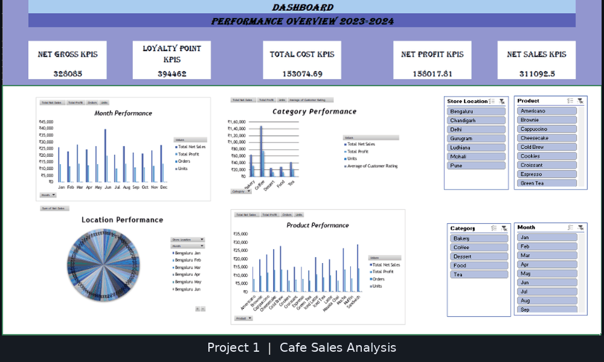
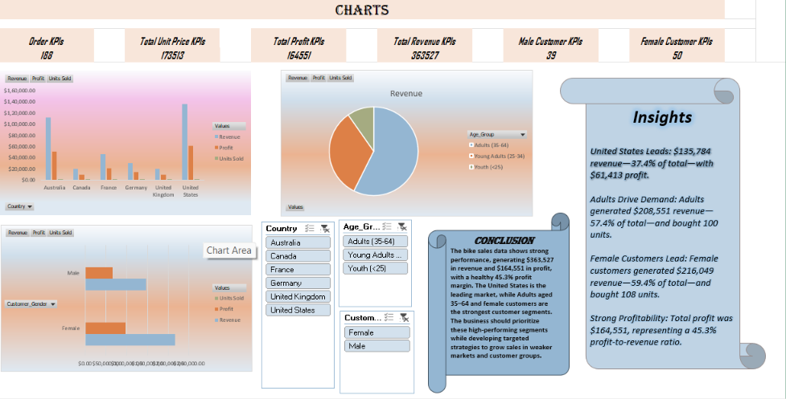
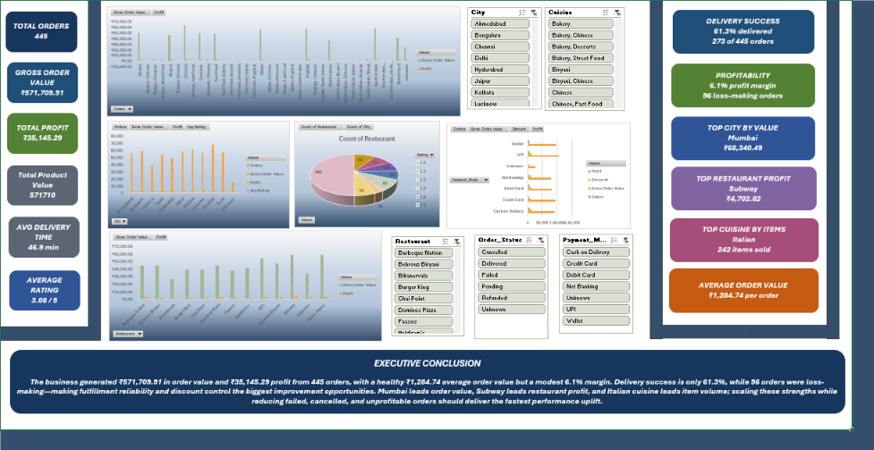
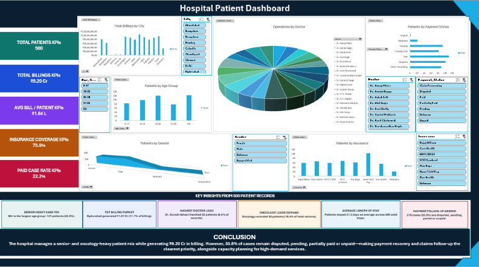
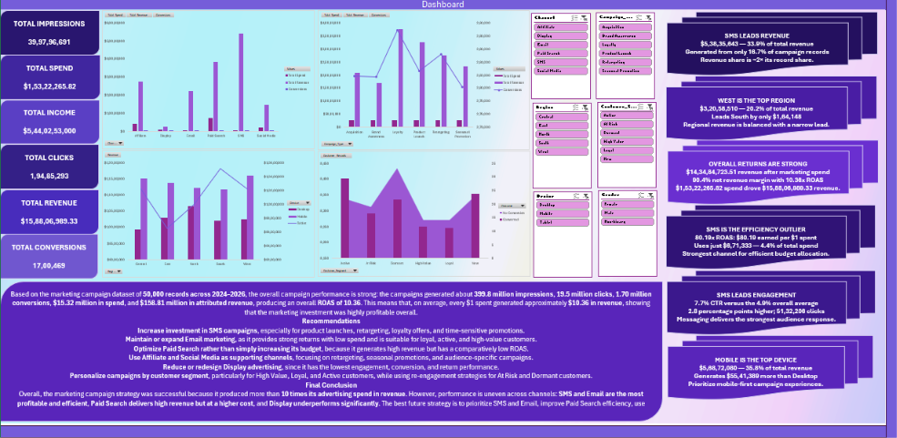

<div align="center">

# 📊 Excel Dashboard Projects

### Messy data in. Clean insights out.

**5 datasets · 34 pivot tables · 22 interactive charts · 1 workflow**


</div>

---

## 🚀 What's This Repo?

Five Excel projects, five industries, one goal: **take a raw dataset and turn it into a clean, interactive dashboard that actually tells you something.**

Projects 1–4 start with messy, broken data that needs real cleaning. Project 5 is a large, clean, modeled dataset, so it focuses on data validation, pivot analysis and dashboard storytelling. Every project follows the same pipeline: prepare the data, summarise it with pivot tables, then build a dashboard with charts and slicers. Each folder also has its own README explaining what was checked or fixed, what the data shows, and what to be careful about.

---

## 🎞️ Dashboard Preview

<div align="center">



</div>

<br>

<table>
  <tr>
    <td align="center" width="20%">
      <a href="Project_1/"></a>
      <br><sub><b>☕ Café Sales</b></sub>
    </td>
    <td align="center" width="20%">
      <a href="Project_2/"></a>
      <br><sub><b>🚴 Bike Sales</b></sub>
    </td>
    <td align="center" width="20%">
      <a href="Project_3/"></a>
      <br><sub><b>🍽️ Zomato Orders</b></sub>
    </td>
    <td align="center" width="20%">
      <a href="Project_4/"></a>
      <br><sub><b>🏥 Hospital Patients</b></sub>
    </td>
    <td align="center" width="20%">
      <a href="Project_5/"></a>
      <br><sub><b>📣 Marketing Campaigns</b></sub>
    </td>
  </tr>
</table>

<div align="center"><sub>Click any dashboard to open its project.</sub></div>

---

## 🔄 The Workflow

<div align="center">

| 🗑️ **Raw Data** | ➜ | 🧹 **Clean** | ➜ | 📐 **Pivot Tables** | ➜ | 📊 **Dashboard** | ➜ | 💡 **Insights** |
|:---:|:---:|:---:|:---:|:---:|:---:|:---:|:---:|:---:|
| Messy, broken, raw | | Standardise, fix, validate | | Summarise | | Charts and slicers | | Findings and caveats |

</div>

---

## 🗂️ The Projects

| | Project | Industry | Dataset | Headline |
|---|---|---|---|---|
| ☕ | [**Café Sales**](Project_1/) | Food & Beverage | 1,600 transactions · 7 stores · 2024 | 311K net sales · ~51% margin |
| 🚴 | [**Bike Sales**](Project_2/) | Retail | 89 records · 6 countries · Dec 2021 | 363.5K revenue · ~45% margin |
| 🍽️ | [**Zomato Orders**](Project_3/) | Food Delivery | 445 orders · 10 cities · 2024 | ₹571.7K order value · ~6% margin |
| 🏥 | [**Hospital Patients**](Project_4/) | Healthcare | 500 patients · 10 cities · 2025 | ₹91.95M total billing |
| 📣 | [**Marketing Campaigns**](Project_5/) | Marketing | 50,000 records · 6 channels · 2024–2026 (synthetic) | $158.8M revenue · 10.36x ROAS |

---

## 🔥 Highlights From Each Project

<details>
<summary><b>☕ Project 1 — Café Sales</b></summary>

<br>

<a href="Project_1/"></a>

- June was the standout month (39.7K), far above every other month.
- Coffee drives about **48%** of net sales.
- Net sales include cancelled and pending orders; only 67% of orders were completed.

</details>

<details>
<summary><b>🚴 Project 2 — Bike Sales</b></summary>

<br>

<a href="Project_2/"></a>

- The **United States** leads with about 37% of revenue, then Australia at 31%.
- Adults (35–64) generate about **57%** of revenue.
- Best seller: Mountain-200 Black, size 46.

</details>

<details>
<summary><b>🍽️ Project 3 — Zomato Orders</b></summary>

<br>

<a href="Project_3/"></a>

- Mumbai is the top city; Subway makes the most profit.
- Only **61%** of orders were actually delivered.
- 22% of orders lost money, and the overall margin is a thin 6%.

</details>

<details>
<summary><b>🏥 Project 4 — Hospital Patients</b></summary>

<br>

<a href="Project_4/"></a>

- Hyderabad has the highest billing (₹10.7M); Oncology is the biggest department.
- Only **22%** of patients have fully paid.
- Messy city names (`Bombay`, `Calcutta`, `Bengaluru`) are flagged in the README.

</details>

<details>
<summary><b>📣 Project 5 — Marketing Campaigns</b></summary>

<br>

<a href="Project_5/"></a>

- **SMS** brings in about **34% of revenue** from only 4.4% of spend (80x ROAS).
- **Display** is the weakest channel (3.5x ROAS), while Paid Search takes the biggest budget share (47%).
- Overall ROAS is **10.36x**, but the dataset is synthetic, so the results are best read as an analysis exercise.

</details>

---

## 🧹 Data Problems I Had To Fight

*(Projects 1–4. Project 5 passed all validation checks with no blanks or duplicates.)*

| Problem | Real example |
|---|---|
| 🔤 Inconsistent text | `Bangalore` / `Bengaluru`, `CC` / `Credit Card`, `DAMA` / `Discharged Against Medical Advice` |
| 📅 Mixed date formats | `2025-05-11`, `05-18-2025`, `27/03/2025`, `11 Oct 2025` |
| 🔢 Numbers stored as text | `₹51,199.60`, `39 mins`, `56 yrs` |
| 🚫 Impossible values | Negative bills, ages of `999`, a `99,999,999` placeholder |
| 🕳️ Missing data | Hundreds of blanks per dataset, handled with medians, modes or `Unknown` |
| 🆔 Broken IDs | `PAT-135`, `ORD_117`, blanks, duplicates |

---

## 🛠️ Skills Showcased


---

## 📂 Repo Structure

```
Excel_Dashboard/
├── 📁 Project_1/   ☕ Café sales
├── 📁 Project_2/   🚴 Bike sales
├── 📁 Project_3/   🍽️ Zomato orders
├── 📁 Project_4/   🏥 Hospital patients
├── 📁 Project_5/   📣 Marketing campaigns
└── 📄 README.md
```

Each project folder contains the Excel workbook, its own README, and an `images/` folder with a dashboard screenshot.

---

## ⚡ Quick Start

1. Pick a project folder.
2. Read its README for the dataset, cleaning steps, findings and caveats.
3. Download the `.xlsx` file and open the dashboard sheet.
4. Click the slicers to filter the charts and explore the data yourself.

---

## 👤 Author

**Mohak Mittal** · [GitHub](https://github.com/Mohak-Mittal)

<div align="center">

⭐ If you found this useful, drop a star on the repo!

</div>
